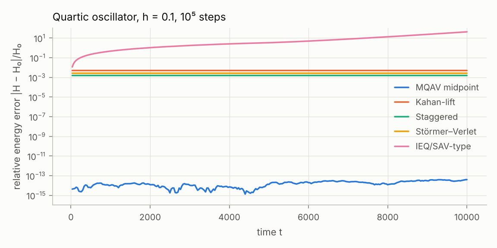
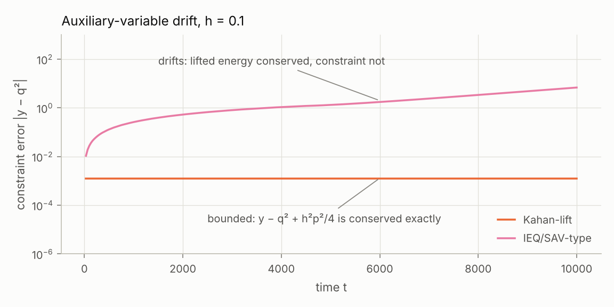
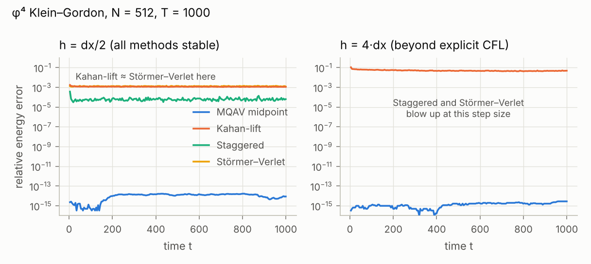
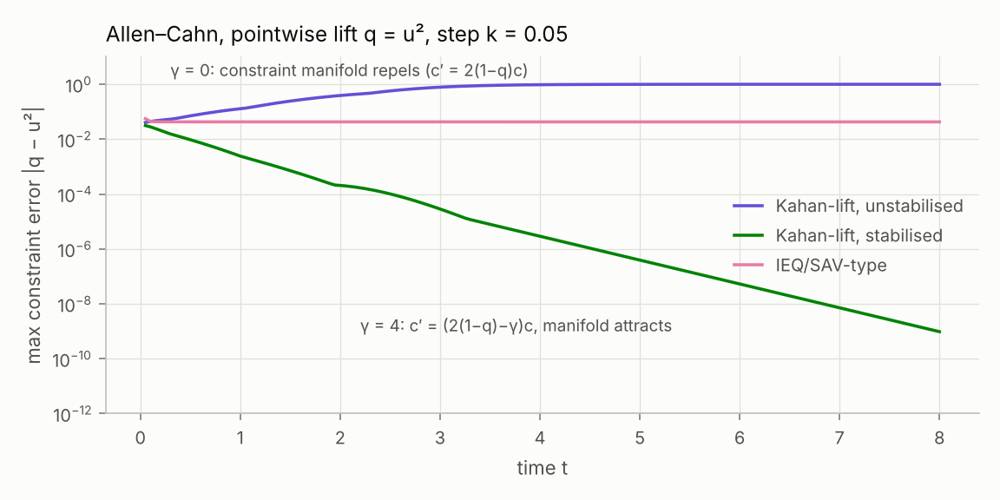

# Quadratic lifts beyond the midpoint rule

> **Folder contents.** Research notes, in order: this note; [Which lift constraints can Kahan's method
> protect?](kahan-invariants.md); [What the Kahan-lift invariants are good for](applications-and-paper-plan.md);
> [Dimensions, affine factors and the integrable class](dimensions-and-integrable-class.md);
> [The Lie–Poisson draft and whether to publish](lie-poisson-draft-and-publication.md). A paper draft for
> *Nonlinearity* built from them is in [`paper/`](paper/) ([PDF](paper/main.pdf)).

*A research note on extending the multiple quadratic auxiliary variable (MQAV) method of
B. K. Tapley, "Geometric integration of ODEs using multiple quadratic auxiliary variables",
SIAM J. Sci. Comput. 44(4), A2651–A2668 (2022), [arXiv:2108.06548](https://arxiv.org/abs/2108.06548).
Every numerical claim below is reproduced by a script in [`code/`](code/); see
[§8](#8-reproducibility).*

*Follow-up note: [Which lift constraints can Kahan's method protect?](kahan-invariants.md) (a block theorem, a classification of protectable constraints, back-substitution, and new invariant measures).*

> **Main takeaway.** Treat the lift as a *design choice*: if you choose the auxiliary variables
> so that every invariant you care about is a quadratic in **two** variables (or uses only
> variables that move **linearly**), then Kahan's method — one linear solve per step — conserves
> modified versions of *all* of them exactly, so nothing drifts and, for one-degree-of-freedom
> problems, the resulting method is even integrable. When no such lift exists, your MQAV midpoint
> method remains the robust choice, and a stabilised or time-staggered lift is the cheap fallback.

## Results at a glance

| Your question | Short answer | Where |
|---|---|---|
| Is a quadratic-invariant-preserving method (midpoint) necessary? | No. You need the constraints conserved in *some* form; an exactly conserved, $O(h^2)$-shifted constraint surface is enough (the same deal a symplectic method gives you for energy). | §1, §3 |
| Can Kahan's method give an even better projected method? | Yes for "Kahan-friendly" lifts. For $H=\tfrac12p^2+U(\varphi(q))$ with $U,\varphi$ quadratic (all symmetric quartic potentials) and for the pendulum, the lifted Kahan map is linearly implicit, symmetric and **integrable**: it conserves a modified constraint, a modified energy and a measure. For general lifts it drifts. | §3 |
| Kahan preserves modified two-variable invariants — can we use that? | Yes: the lifted constraints are *born* as two-variable (or "linear-factor") invariants. I also prove a small companion lemma covering constraints with three or more variables. | §2, §3.2 |
| What does a different basis buy? | It decides which invariants Kahan can protect, whether the lifted Poisson structure is linear, whether positivity survives, and the conditioning. | §4 |
| Splitting in the lifted space? | Splittings that keep the constraint sheet invariant reduce to splittings of the original system, but the lift tells you which pieces are exactly solvable. Staggering $x$ and $y$ in time gives a linearly implicit scheme with an exactly conserved discrete energy (generalising Besse's NLS scheme), but it is only conditionally stable. | §5 |
| PDEs? | Second-order-in-time PDEs (nonlinear wave, Klein–Gordon, FPU-type lattices) are the natural Kahan-friendly class: one sparse solve per step, the constraint at every grid point is protected, and the method is stable far beyond the explicit time-step limit. For dissipative PDEs, design the lift so that the constraint sheet *attracts*: in an Allen–Cahn test this was 5–20 times more accurate than a standard linearly implicit IEQ scheme. | §6 |

---

## 0. Abbreviations and notation (read this first)

**Abbreviations.**
ODE / PDE = ordinary / partial differential equation.
MQAV = multiple quadratic auxiliary variables (your method: lift, apply the midpoint rule, eliminate the auxiliary variables).
SAV / IEQ = scalar auxiliary variable / invariant energy quadratization (linearly implicit single-variable relatives used for PDEs).
RK = Runge–Kutta. DOF = degree of freedom. CFL = Courant–Friedrichs–Lewy (the time-step limit of explicit schemes).
CMOQ = Celledoni, McLaren, Owren and Quispel (2019), the "two-variable" theorem for Kahan's method.
My labels: **KL** ("Kahan-lift") = Kahan's method applied to the lifted system; **STAG** = the staggered scheme of §5.3; **SV** = Störmer–Verlet.

**Notation.**

| Symbol | Meaning |
|---|---|
| $\dot x=f(x)$, $x\in\mathbb R^n$ | the original ODE; often $f=S(x)\nabla H$ with $S$ skew-symmetric |
| $H$ | a polynomial first integral (invariant, conserved quantity) |
| $y=\varphi(x)\in\mathbb R^m$ | auxiliary variables ("the lift"), e.g. $y_{ij}=x_ix_j$ |
| $z=(x,y)$ | lifted state; $\iota(x)=(x,\varphi(x))$ is the embedding |
| $c(z)=y-\varphi(x)$ | constraint functions |
| $\mathcal M=\lbrace c=0\rbrace$ | the constraint sheet (the copy of the original phase space the exact solution lives on) |
| $F(z)$ | lifted vector field: any field with $F(\iota(x))=D\iota(x)f(x)$; if quadratic, $F(z)=Q(z,z)+Bz+b$ with $Q$ symmetric bilinear |
| $\tilde H(z)$ | quadratic lifted invariant with $\tilde H(\iota(x))=H(x)$ |

**Kahan's method** for a quadratic field (also called the Kahan–Hirota–Kimura discretisation):

$$\frac{z'-z}{h}=Q(z,z')+B\,\frac{z+z'}{2}+b\qquad\Longleftrightarrow\qquad z'=z+h\Big(I-\tfrac h2F'(z)\Big)^{-1}F(z).$$

Every quadratic term is evaluated as "half old × new + half new × old". The new state appears
linearly, so a step costs **one linear solve and no iteration**.

**Running example** (your §2.1.1): the quartic oscillator $H=\tfrac12p^2+\tfrac14q^4$ with
$y=q^2$:

$$\dot q=p,\qquad \dot p=-qy,\qquad \dot y=2qp,\qquad \tilde H=\tfrac12p^2+\tfrac14y^2,\qquad c=y-q^2 .$$

**Intuition.** Think of $y$ as a bookkeeping variable that is supposed to always equal $q^2$.
The midpoint rule keeps the books balanced because $y-q^2$ is a quadratic invariant, and the
midpoint rule conserves every quadratic invariant. A cheaper method lets $y$ slide away from
$q^2$. The whole question is whether the slide is *bounded and harmless* or a *drift*.

---

## 1. A picture that explains why drift matters

Change coordinates on the lifted space from $(x,y)$ to $(x,c)$ with $c=y-\varphi(x)$. Your
extended system $\dot z=K(z)\nabla\tilde H$ (Remark 1 of the paper) then becomes

$$\dot x=S(x)\,\nabla_x\Big[\tilde H\big(x,\varphi(x)+c\big)\Big],\qquad \dot c=0 .$$

So **the lifted space is a stack of copies of the original system, one for each value of $c$**.
The copy at $c\neq0$ has the *deformed* Hamiltonian $H_c(x)=\tilde H(x,\varphi(x)+c)$. For the
quartic oscillator, $H_c=\tfrac12p^2+\tfrac14(q^2+c)^2$, which is a double well when $c<0$.

What this gives you:

1. In $(x,c)$ coordinates the structure matrix is $S(x)\oplus 0$. So the extended system is
    Poisson whenever the original one is, and every constraint function is a Casimir. (The MQAV
    midpoint map is not symplectic because $(x,y)\mapsto(x,c)$ is nonlinear and the midpoint rule
    only respects *affine* changes of variables — the structure itself is not destroyed.) I have
    not seen this stated explicitly, though it is elementary and may well be known.
2. A method that does not conserve $c$ hops between deformed copies. If $c$ **drifts**, you
    end up simulating the wrong system. That is exactly what happens to linearly implicit
    SAV/IEQ-type schemes (Figure 2). If $c$ only **wobbles** within an $O(h^2)$ band, you simulate
    a nearby system forever, which is the guarantee symplectic methods give for energy.

---

## 2. What is known about Kahan's method (the ingredients)

* Kahan's method is linearly implicit and time-symmetric. On quadratic fields it coincides with
    a non-symplectic RK method, so it does **not** conserve quadratic invariants in general.
* It nevertheless conserves *modified* invariants surprisingly often:
    * [Celledoni, McLachlan, Owren & Quispel 2013](https://arxiv.org/abs/1209.1164): for
        $\dot z=K\nabla H$ with constant $K$ and cubic $H$, a modified energy and a measure are conserved.
    * [CMOQ 2019](https://arxiv.org/abs/1805.08382) (the "two-variable" result you mention): let
        $I(z_1,z_2)=\tfrac12a_1z_1^2+a_2z_1z_2+\tfrac12a_3z_2^2+a_4z_1+a_5z_2$ be a quadratic
        integral depending on **two** variables, so that $\dot z_1=A(z)\,\partial_2I$ and
        $\dot z_2=-A(z)\,\partial_1I$ with $A$ affine. Then Kahan conserves exactly

        $$\tilde I=\frac{I+\tfrac18h^2D_2A^2}{1+\tfrac14h^2D_1A^2},\qquad
        D_1=a_1a_3-a_2^2,\qquad D_2=2a_2a_4a_5-a_3a_4^2-a_1a_5^2 .$$

---

## 3. Kahan's method in the lifted space (your questions 2 and 4)

### 3.1 The key observation

The lifted constraints are *born* in the classes where Kahan behaves well:

* $y-q^2$ involves only the two variables $(q,y)$, and $\dot q=p$ is affine — CMOQ applies
    with $A=p$.
* $y_{ij}-x_ix_j$ involves three variables, but if $x_i$ and $x_j$ move by an affine law, the
    lemma below applies.

The lift can therefore be *designed* so that everything you want conserved falls into one of
these two classes.

### 3.2 A companion lemma (constraints with any number of variables)

**Lemma.** Let $F(z)=Q(z,z)+Bz+b$, and let $I(z)=\tfrac12z^\top Sz+s^\top z$ be a first integral
of $\dot z=F(z)$. If $S\,Q(u,v)=0$ for all $u,v$ — that is, the variables appearing in the
quadratic part of $I$ move by an affine law — then Kahan's map conserves exactly

$$\tilde I_h(z)=I(z)-\frac{h^2}{8}\,F(z)^\top S\,F(z).$$

*Proof.* Write $\Delta=z'-z$ and $\bar z=\tfrac12(z+z')$. Kahan's method reads
$\Delta=h\big(F(\bar z)-\tfrac14Q(\Delta,\Delta)\big)$.

1. Since $I$ is quadratic, $I(z')-I(z)=\nabla I(\bar z)^\top\Delta=-\tfrac h4\,s^\top Q(\Delta,\Delta)$.
    This uses $\nabla I\cdot F\equiv0$ and $\bar z^\top SQ=0$.
2. $F(z')-F(z)=2Q(\bar z,\Delta)+B\Delta$, so $S\big(F(z')-F(z)\big)=SB\Delta$. Also
    $F(z')+F(z)=2F(\bar z)+\tfrac12Q(\Delta,\Delta)$. Hence
    $F(z')^\top SF(z')-F(z)^\top SF(z)=2F(\bar z)^\top SB\Delta=\tfrac2h\,\Delta^\top SB\Delta$.
3. The quadratic part of the identity $\nabla I\cdot F\equiv0$ says $z^\top SBz+s^\top Q(z,z)=0$,
    so $\Delta^\top SB\Delta=-s^\top Q(\Delta,\Delta)$.

Putting these together, $\tilde I_h(z')-\tilde I_h(z)=-\tfrac h4 s^\top Q(\Delta,\Delta)+\tfrac h4 s^\top Q(\Delta,\Delta)=0$. $\blacksquare$

**In plain words.** For variables that move linearly, Kahan's method *is* the midpoint rule,
and the midpoint rule conserves quadratic invariants. The only leftover is a small
"velocity × velocity" term, and that term is itself an exact difference. So the conserved
quantity is the original invariant minus an $h^2$-small correction built from velocities. For a
constraint $y-x_ix_j$ with $\dot x_i,\dot x_j$ affine:

$$\tilde c_h=y-x_ix_j+\tfrac{h^2}{4}\,\dot x_i\,\dot x_j .$$

The lemma agrees with CMOQ where both apply (the case $D_1=0$), and it covers constraints with
three or more variables. Numerically the conservation holds to $10^{-16}$ (relative) on a random
7-dimensional system with the three-variable constraint $y_{12}-a_1a_2$ (`lemma_random2.py`).
I have not found the lemma in the literature.

### 3.3 Worked example: the quartic oscillator becomes an *integrable* linearly implicit method

Kahan applied to the lift is a $3\times3$ linear system per step:

$$q'-q=\tfrac h2(p+p'),\qquad p'-p=-\tfrac h2(q\,y'+q'\,y),\qquad y'-y=h\,(q\,p'+q'\,p).$$

It conserves exactly (symbolic proof in `sym_kahan_check.py` and `sym_quartic_energy.py`; exact
rational-arithmetic check in `exact_measure.py`):

| Conserved quantity | Why |
|---|---|
| modified constraint $\ y-q^2+\tfrac{h^2}{4}p^2$ | two variables $(q,y)$, $A=p$ (also the lemma) |
| modified energy $\ \hat H_h=\dfrac{\tfrac12p^2+\tfrac14y^2}{1+\tfrac12h^2q^2}$ | two variables $(p,y)$, $A=-2q$, $D_1=\tfrac12$, $D_2=0$ |
| measure $\ \dfrac{dq\,dp\,dy}{1+\tfrac12h^2q^2}$ | the denominator is a discrete Darboux polynomial with the Jacobian as cofactor |

Two integrals plus a measure in three dimensions means every orbit lies on the intersection of
two quadrics: the map is **integrable**. As an independent check, the orbit-based test in
`quartic_kahan.py` finds exactly two quadratic relations, and its relation counts at degrees
2–6 (2, 8, 19, 36, 60) match the ideal of two quadrics exactly. This fits the CMOQ mechanism (and
may sit inside their 10-parameter integrable family; the [follow-up note](kahan-invariants.md#3-a-family-where-the-constraint-needs-a-partner-one-dof-lifts) shows that it does). The new point is that **the MQAV lift
lands you there**.

**A "projected Kahan" method on the original phase space.** Start the auxiliary variable on the
*shifted* sheet $y_0=q_0^2-\tfrac{h^2}4p_0^2$. Then $y_n=q_n^2-\tfrac{h^2}{4}p_n^2$ for all $n$,
so $(q_n,p_n)\mapsto(q_{n+1},p_{n+1})$ is a genuine one-step map $\psi_h$ on $\mathbb R^2$. It
is second order, symmetric ($\psi_{-h}=\psi_h^{-1}$), reversible and linearly implicit, and it
conserves the modified energy $\hat H_h(q,p,q^2-\tfrac{h^2}4p^2)$. So **the original energy error
is $O(h^2)$ uniformly in time**, without solving a nonlinear system.

*Figure 1. Envelope (maximum per time bin) of the relative energy error, $h=0.1$, $10^5$ steps.*

*Figure 2. The auxiliary variable $y$ against $q^2$ for the two linearly implicit lifted methods
that carry $y$.*

| Method ($h=0.1$, $(q_0,p_0)=(1,\tfrac12)$, $T=10^4$) | Cost per step | Max relative energy error | Max $\lvert y-q^2\rvert$ | Global error at $T=10$, $h=0.0125$ (order) |
|---|---|---|---|---|
| MQAV midpoint (your method; equals AVF here) | Newton, 3.2 iterations of a 2×2 solve | $4\times10^{-14}$ | eliminated | $2.3\times10^{-4}$ (2) |
| Kahan-lift | one 3×3 solve | $5.0\times10^{-3}$, no drift | $1.2\times10^{-3}$, no drift | $4.2\times10^{-4}$ (2) |
| Kahan-lift from shifted sheet (one-step map $\psi_h$) | one 3×3 solve | $5.8\times10^{-3}$, no drift | on shifted sheet exactly | $4.8\times10^{-4}$ (2) |
| Staggered, §5.3 | one 2×2 solve | $1.5\times10^{-3}$ | — | $7.0\times10^{-5}$ (2) |
| Störmer–Verlet | explicit | $2.6\times10^{-3}$ | — | $1.4\times10^{-4}$ (2) |
| Linearly implicit IEQ/SAV-type (extrapolated $K$) | one 3×3 solve | **43** (drift) | **6.9** (drift) | — |

**How far does this generalise?**

* **Integrable whenever $H=\tfrac12p^2+U(\varphi(q))$ with $U,\varphi$ quadratic.** This covers
    every quartic potential that is symmetric about some point: Duffing $\tfrac12q^2+\tfrac14q^4$,
    the double well $\tfrac14(q^2-1)^2$, and so on. Lift $y=\varphi(q)$ (a *shifted* basis such as
    $y=(q-a)^2$ when the symmetry point is $a$); both invariants are then two-variable.
* **Non-symmetric quartic potentials** (tested: $V=\tfrac14q^4+\tfrac13q^3+\tfrac12q^2$). Here
    $V\neq U\circ\varphi$ and the lifted energy also depends linearly on $q$. The modified
    constraint is still exact and the energy error stayed bounded (absolute error
    $4.0\times10^{-3}$ in both the first and last 10% of $4\times10^5$ steps), but the map is not integrable: there is no
    algebraic second integral up to degree 8.
* **Many degrees of freedom**, $H=\tfrac12p^\top M^{-1}p+V(q)$ with quartic $V$ (FPU-β, φ⁴
    lattices, discretised nonlinear wave equations). Lift **positions only**: $y_{ij}=q_iq_j$, or
    $r_j=(q_{j+1}-q_j)^2$. By the lemma, every constraint
    $y_{ij}-q_iq_j+\tfrac{h^2}4\dot q_i\dot q_j$ is conserved exactly. The energy is no longer
    two-variable, so it is only approximately conserved (§6).
* **Higher order.** The Yoshida triple jump of the Kahan-lift map is fourth order (observed rates
    3.89, 3.97, 3.99). Each sub-step conserves its *own* $h_i$-dependent modified constraint, so
    the composition conserves none exactly. Even so, over $2\times10^5$ steps the constraint error
    ($5.0\times10^{-5}$) and energy error ($4.4\times10^{-5}$) did not grow (`kahan_composition.py`).

### 3.4 The pendulum: a trigonometric basis gives an integrable pendulum map

Lift $s=\sin q$, $c=\cos q$ and drop $q$ altogether:

$$\dot s=c\,p,\qquad \dot c=-s\,p,\qquad \dot p=-s .$$

Both invariants are two-variable: $E=\tfrac12p^2-c$ in $(p,c)$ with $A=s$, and
$K=\tfrac12(s^2+c^2)$ in $(s,c)$ with $A=p$. So Kahan conserves exactly

$$E_h=\tfrac12p^2-c-\tfrac{h^2}{8}s^2,\qquad K_h=\frac{s^2+c^2}{1+\tfrac14h^2p^2}.$$

Test: $h=0.25$, large swing $q_0=2.5$, $2\times10^5$ steps. Both drift by only $5\times10^{-14}$,
orbits lie on the intersection of two quadrics, and the true energy error stays at
$2.5\times10^{-2}$ (about 3% of $E_0=0.80$) with no growth. The map also preserves the measure
$ds\,dc\,dp/(1+\tfrac14h^2p^2)$ — again the denominator of a modified invariant
(`pendulum_measure.py`). This is an integrable, linearly implicit pendulum.

**Warning, and a design rule.** If you also keep $q$ as a variable ($\dot q=p$), the relation
"angle of $(c,s)$ equals $q$" is not algebraic, so nothing protects it. For a *rotating* pendulum
the mismatch grows linearly, from about 20 to about 2000 radians over the run (`pendulum.py`).
**Every relation that ties lifted variables together must itself be a protected algebraic
invariant.**

### 3.5 When Kahan fails, and what to do instead

Take your §5.1 example $H=\tfrac12x_1^2+x_2^4+x_1^2x_2^2$. A *quadratic* lifted field needs all
quadratic monomials $y_{11},y_{12},y_{22}$. The constraint factors $x_1,x_2$ then move
nonlinearly, so no constraint is protected (`nonseparable.py`, $h=0.05$):

* The constraint error reaches $0.4$ by $t=20$ and $O(1)$ by $t=200$.
* "Kahan + reset $y:=\varphi(x)$ every step" is a one-step method, but its energy error drifts
    linearly: $5.8\times10^{-4}$ at $t=20$, $6.5\times10^{-3}$ at $t=200$, $4.0\times10^{-2}$ at
    $t=2000$.

The options in this situation:

* Keep the **MQAV midpoint**. It is robust: with a Newton solver it stayed exact and stable up to
    $x_1(0)=10.67$ at $h=0.1$ in your Figure 2 test, i.e. also for $i=13$, where the paper's
    fixed-point iteration failed. That suggests the instability you saw at $i=13$ may come from
    the nonlinear solver rather than the method.
* Use the Kahan-lift step as a **predictor plus one Newton step** of MQAV (§6.2).
* **Change the basis** (§4, item 4).
* Use the **staggered scheme** (§5.3), at the price of a step-size limit.

### 3.6 Checklist for a "Kahan-friendly" lift

1. Each constraint $y-\varphi(x)$ should be either two-variable with an affine factor $A$ (CMOQ)
    or built only from affinely moving variables (the lemma). For mechanical systems: **lift
    positions, not momenta.**
2. No redundant variables tied together by non-algebraic relations (the pendulum warning).
3. Make protected two-variable invariants **definite** ($D_1\ge0$). Otherwise the denominator
    $1+\tfrac14h^2D_1A^2$ can vanish and protection is lost when $h\lvert A\rvert$ is large (seen
    in §4, item 4).
4. The energy is protected only if it is itself two-variable or affine-factor. Otherwise expect a
    bounded but inexact energy (often fine), or slow growth at very large $h$ (FPU, §6.4).

---

## 4. What a different basis buys (your question 1)

The basis decides *which invariants a cheap method can protect*. Concrete options:

1. **Shifted or centred quadratics**, $y=(q-a)^2$ or $y=q^2+bq$. These make potentials that are
    symmetric about $a$ two-variable, so Kahan is integrable on them (§3.3).
2. **Position-only lifts** for mechanical systems. The constraints are exact Casimirs, they are
    Kahan-protected, and Hamiltonian splitting in the lifted space reproduces Störmer–Verlet.
3. **All quadratic monomials give a *linear* Poisson structure.** For canonical $S$, the Poisson
    bracket of two quadratic monomials is again a quadratic polynomial. Replacing it by the
    corresponding $y$'s gives a Poisson tensor that is linear in $z$: the Lie–Poisson structure of
    the Lie algebra of polynomials of degree at most 2 (Heisenberg ⋊ symplectic, the "Jacobi
    algebra"). Every quartic Hamiltonian then becomes a *quadratic* Lie–Poisson Hamiltonian — a
    generalised rigid body — and $\mathcal M$ is a coadjoint orbit.
    * *Intuition:* read $(x,y)$ as the mean and second moment of a Gaussian cloud. Then $y-xx^\top$
        is its covariance, and $\mathcal M$ is the zero-width cloud. Kahan's modified constraint
        $y-q^2=-\tfrac{h^2}4(p^2-p_0^2)$ is a step-size-sized "width".
    * *Gains:* a quadratic right-hand side (Kahan applies), exactly solvable splittings (§5.1), and
        Lie–Poisson integrators.
    * *Caveat:* the constraint factors move nonlinearly, so Kahan drifts (§3.5).

4. **Reduced (quotient) lifts that drop $x$ entirely.** For an even Hamiltonian use
    $(y,w,u)=(q^2,p^2,qp)$. For your §5.1 example ($q=x_2$, $p=x_1$) this gives a closed 3D system

    $$\dot y=2u+4uy,\qquad \dot w=-4u(w+2y),\qquad \dot u=w-4y^2,\qquad \tilde H=\tfrac12w+yw+y^2 .$$

    Here $\tilde H$ is two-variable with $A=4u$, so Kahan conserves
    $(\tilde H-h^2u^2)/(1-4h^2u^2)$ exactly (to $10^{-13}$, `reduced_lift.py`). Moreover
    $H(q,p)=\tilde H(y,w)$ holds exactly for the reconstruction $q=\pm\sqrt y$, $p=\pm\sqrt w$.
    *Caveat:* $\tilde H$ is indefinite ($D_1=-1$), so the denominator can vanish. The method works
    at moderate amplitude but breaks down from $x_1(0)\approx9.3$ at $h=0.1$.
    *Related:* for U(1)-symmetric systems (discrete NLS, Bose–Hubbard) the analogous lift is the
    "density matrix" $\rho_{ij}=\psi_i\bar\psi_j$, a Lie–Poisson system on $\mathfrak u(n)^{\ast}$.

5. **Trigonometric bases** (§3.4), and **Chebyshev or other orthogonal-polynomial bases**
    $y_k=T_k(x)$ with $T_mT_n=\tfrac12(T_{m+n}+T_{\lvert m-n\rvert})$. The latter give quadratic
    constraints that are much better conditioned than monomials for high-degree lifts (not tested
    here).

6. **Quasi-monomial (Lotka–Volterra) bases** (Brenig–Goriely). Every quasi-polynomial ODE embeds
    into $\dot z_j=z_j\big(\lambda_j+(Mz)_j\big)$.
    * Each $z_j$ is a *linear* Darboux polynomial (second integral). By your 2021 result every RK
        method keeps the invariant hyperplanes $z_j=0$, and Kahan's method does too, since
        $z_j'=z_j\,\frac{1+\frac h2\ell_j(z')}{1-\frac h2\ell_j(z)}$ with $\ell_j(z)=\lambda_j+(Mz)_j$.
    * Multiplicative constraints $\prod_j z_j^{c_j}=\text{const}$ are conserved exactly by a
        "column" splitting: each piece $\dot z_i=z_iM_{ik}z_k$ with $z_k$ frozen is an explicit
        exponential.
    * Conceptual only; not tested here.

7. **Fewest variables.** A quadratic *invariant* and a quadratic *vector field* are different
    requirements. The octic oscillator needs $y_1=q^2$ and $y_2=q^4$ for a quadratic $\tilde H$
    (your §2.2), but its MQAV field $\dot p=-q\,y_1y_2$ is cubic. A quadratic field also needs
    $u=q^3$, giving $\dot p=-u\,y_2$. Optimal-quadratisation algorithms (Bychkov–Pogudin, QBee)
    find the smallest such set of variables.

**The second design dial: how the field is extended off the constraint sheet.** Three options:

* **Exact-invariant extension** (your paper): $c$ is conserved, but the right-hand side may have
    higher degree.
* **Quadratic-right-hand-side extension**: $c$ is often only a Darboux polynomial,
    $\dot c=\kappa(z)\,c$, so the sign of $\kappa$ decides whether $\mathcal M$ attracts or repels.
* **Stabilised extension**: add $-\gamma\,c(z)$ to $\dot y$. This keeps the right-hand side
    quadratic and makes $\mathcal M$ attracting (§6.3).

---

## 5. Splitting in the lifted space (your question 3)

### 5.1 Hamiltonian splitting: no new methods, but a recipe for solvable pieces

If every sub-flow keeps $\mathcal M$ invariant (for example, sub-Hamiltonians under the lifted
Poisson structure, where the constraints are Casimirs), then lifted splitting *is* a splitting of
the original system. What the lift adds is a way to **find exactly solvable pieces**.

In Lie–Poisson coordinates, a piece $\tfrac12(\ell^\top z)^2$ conserves $\ell^\top z$ along its
own flow. Its flow is therefore *linear* in $z$ (a coadjoint action), and it keeps $\mathcal M$
exactly. In the original variables this is a piece $\tfrac12G(x)^2$ with $G$ quadratic: the
(linear) flow of $G$ run at the frozen speed $G(x_0)$. Every quartic Hamiltonian is a signed sum
of such squares plus a quadratic part. Example — your §5.1 Hamiltonian, written as $\tfrac12x_1^2+x_2^4+(x_1x_2)^2$:

* $\tfrac12x_1^2$: $x_2\mapsto x_2+t\,x_1$;
* $x_2^4$: $x_1\mapsto x_1-4t\,x_2^3$;
* $(x_1x_2)^2$: $(x_1,x_2)\mapsto(x_1e^{-2Gt},x_2e^{2Gt})$ with $G=x_1x_2$.

Strang composition of these gives an explicit symplectic method (`nonsep_methods.py`). In your
Figure 2 test ($h=0.1$) it is stable only up to $x_1(0)=3.33$, with energy errors of 0.08–0.9,
whereas the MQAV midpoint is stable up to 10.67. Explicit methods pay in stability.

### 5.2 Splitting the structure matrix keeps energy exactly

Write $K=\sum_jK_j$ with each $K_j$ skew and annihilating all constraint gradients — for example,
the per-DOF pieces of the pushforward structure. Each piece conserves $\tilde H$ *and* all
constraints. Integrating each piece with a midpoint step (a tiny local quadratic problem) and
composing them gives an exactly energy-conserving method that needs only *local* solves. This is
the lifted analogue of Itoh–Abe / coordinate-increment discrete gradients (not tested here).

### 5.3 Staggering $x$ and $y$ in time: exact discrete energy, linearly implicit

Take $\tilde H=\tfrac12x^\top Ax+\tfrac12y^\top By+\beta^\top y$ and keep $y$ at half steps:

$$\tfrac12\big(y^{n+\frac12}+y^{n-\frac12}\big)=\varphi(x^n)\quad\text{(explicit)},\qquad
\frac{x^{n+1}-x^n}{h}=S_\ast\Big[A\bar x+D\varphi(\bar x)^\top\big(By^{n+\frac12}+\beta\big)\Big]\quad\text{(linear in }x^{n+1}).$$

Here $\bar x=\tfrac12(x^n+x^{n+1})$ and $S_\ast$ is any skew matrix (for example $S$ evaluated at an
extrapolated point).

* Taking the inner product with the bracket gives an **exactly conserved** discrete energy
    $$E^n=\tfrac12x_n^\top Ax_n+\tfrac12\big(y^{n-\frac12}\big)^\top By^{n+\frac12}+\beta^\top\varphi(x^n),
    \qquad H(x^n)-E^n=\tfrac18\,\Delta y^\top B\,\Delta y=O(h^2).$$
* The constraint holds *on average* exactly: $\tfrac12(y^{n+\frac12}+y^{n-\frac12})=\varphi(x^n)$.
* For NLS with $\rho=\lvert\psi\rvert^2$ this is precisely Besse's relaxation scheme (2004), so
    the scheme above is its multiple-auxiliary-variable generalisation.
* When it is stable, it was the most accurate linearly implicit option: Figure 1 and the table in
    §3.3, and the Klein–Gordon test in §6.2.
* It is only **conditionally stable**. The leapfrog-type parasitic mode can grow, and $E^n$ is
    indefinite, so it does not bound the solution. In your §5.1 example it fails at $h=0.1$ already
    for $x_1(0)=2$ (stable for $h\le0.05$, with errors $O(h^2)$, `stag_probe.py`). For Klein–Gordon
    it fails at $h=4\,dx$ over long times.

### 5.4 Splitting or composing Kahan maps

Kahan's modified invariants depend on $h$, so splitting or composition cannot keep them exactly.
Symmetric compositions nevertheless kept every error bounded in practice (Yoshida, §3.3).

---

## 6. PDEs

### 6.1 Pointwise lifts: cost and stability

For a semi-discretised PDE the lift is *pointwise*: $w_j=u_j^2$ at every grid point. For the
nonlinear Klein–Gordon equation $u_{tt}=u_{xx}-u-u^3$:

$$\dot u=v,\qquad \dot v=D_2u-u-u\circ w,\qquad \dot w=2\,u\circ v .$$

Here $D_2$ is the discrete Laplacian and $\circ$ is the pointwise product.

* **Cost.** Eliminating $u'$ and $w'$ (Schur complement) reduces a Kahan step to **one sparse
    solve** with
    $I-\tfrac{h^2}4\big(D_2-I-\operatorname{diag}w\big)+\operatorname{diag}\big(\tfrac{h^2}2u^2+\tfrac{h^3}4uv\big)$,
    which has the same sparsity as Crank–Nicolson for the linear wave equation.
* **Stability.** The linear part is treated by the midpoint/trapezoidal rule, so the method is
    A-stable on it.
* **Constraints.** Every grid point carries a constraint protected by the lemma:
    $w_j-u_j^2+\tfrac{h^2}4v_j^2$ is conserved to $10^{-15}$.
* **Lift then discretise, or discretise then lift?** For finite differences and collocation the
    two commute. For Galerkin methods the lift is $y=\Pi(u^2)$ with an $L^2$ projection $\Pi$. That
    is still a quadratic constraint, but quadrature and mass matrices enter.

### 6.2 φ⁴ Klein–Gordon test

Setup: $N=512$, periodic domain $[-20,20)$, $u_0=2\operatorname{sech}x$, $v_0=0$, $T=1000$
(`kg_pde.py`, `kg_series.py`, `kl_predictor.py`).

*Figure 3. Relative energy error envelopes. Left: $h=dx/2$. Right: $h=4\,dx$, where the explicit
method and the staggered scheme are unstable.*

| Method | Sparse solves per step | Rel. energy error, $h=dx/2$ | Rel. energy error, $h=4\,dx$ | Max error in $u$ at $T=10$, $h=dx$ / $4\,dx$ |
|---|---|---|---|---|
| MQAV midpoint (Newton) | 3 / 4 | $2\times10^{-14}$ | $3\times10^{-15}$ | $5.0\times10^{-2}$ / $0.58$ |
| Kahan-lift | 1 | $1.8\times10^{-3}$, no drift | $0.11\to0.05$, no drift | $5.5\times10^{-2}$ / $0.63$ |
| Kahan-lift predictor + **one** Newton step of MQAV | 2 | $5\times10^{-12}$ ($T=100$) | $5\times10^{-5}$ ($T=100$) | — |
| Staggered (§5.3) | 1 | $3.7\times10^{-4}$ | unstable before $T=1000$ | $4.1\times10^{-2}$ / $0.52$ |
| Störmer–Verlet | explicit | $1.5\times10^{-3}$ | unstable | $2.2\times10^{-2}$ / unstable |

Reading: the Kahan-lift costs a third to a quarter of MQAV's solves, keeps the constraints, and
has a bounded energy error. Adding a single Newton correction recovers almost exact energy
conservation for two solves per step, because the Kahan-lift step is already $O(h^3)$-close to
the MQAV step and Newton converges quadratically. Wall times in Python were 44 s versus 110 s
($h=dx/2$) and 5 s versus 18 s ($h=4\,dx$).

### 6.3 Dissipative PDEs: make the constraint sheet attract

For Allen–Cahn, $u_t=\varepsilon^2u_{xx}+u-u^3$ with $q=u^2$ and a quadratic right-hand side, the
constraint error obeys $\dot c=2(1-q)\,c$, so **$\mathcal M$ repels** wherever $\lvert u\rvert<1$
(in the interfaces). Adding $-\gamma(q-u^2)$ to $\dot q$ gives $\dot c=\big(2(1-q)-\gamma\big)c$,
which attracts for $\gamma>2$ (`allen_cahn.py`; $N=256$, $\varepsilon=0.08$, $T=8$, error measured
against a Richardson-extrapolated reference).

*Figure 4. Constraint error over time for step $k=0.05$.*

| Step $k$ | Kahan, $\gamma=0$ | Kahan, $\gamma=4$ (stabilised) | Linearly implicit IEQ |
|---|---|---|---|
| 0.01 | 0.19 (constraint error grows to 1) | $3.0\times10^{-5}$ | $6.0\times10^{-4}$ |
| 0.05 | 0.38 | $7.3\times10^{-4}$ | $8.6\times10^{-3}$ |
| 0.2 | 0.55 | $1.0\times10^{-2}$ | $4.6\times10^{-2}$ |

With $\gamma=4$, the constraint error decays to $10^{-8}$–$10^{-11}$ and the **true** energy
decreased monotonically at every step size. This is observed, not proven. IEQ guarantees only
that its *modified* energy decreases; its true energy was not monotone, and its constraint error
persists (up to 0.28).

### 6.4 Which PDEs are natural for the Kahan-lift?

* **Second-order in time** is the natural class, because $u_t=v$ is affine: nonlinear wave and
    Klein–Gordon equations; FPU-type lattices ($r_j=(q_{j+1}-q_j)^2$); nonlinear beams with cubic
    stress ($w=u_x^2$); molecular dynamics with quartic bond potentials
    ($r_{ij}=\lvert q_i-q_j\rvert^2$).
* **FPU-β caveat** (non-integrable, persistent nonlinearity: $N=32$, energy in mode 1, amplitude
    4, $T=10^5$, `fpu_long.py`).
    * At $h=0.2$ the Kahan-lift energy error saturates at $2.5\times10^{-2}$, against
        $9.5\times10^{-3}$ for Störmer–Verlet. Neither drifts; both grow as energy spreads to higher
        modes.
    * At $h=0.5$ Störmer–Verlet blows up, while the Kahan-lift energy error grows slowly
        ($3.5\times10^{-2}\to0.17$).
    * The Kahan-lift is not symplectic: protected constraints do not imply energy control.
* **Sine-Gordon via trigonometric lifts** has two pitfalls, one per lift (`sine_gordon.py`,
    `sine_gordon_B.py`):
    * Lift $(s,c,v)$ with cosine coupling $1-\cos(u_{j+1}-u_j)=1-c_{j+1}c_j-s_{j+1}s_j$. The
        per-site circles are protected, but the energy is not, and it drifts (up to 130% at
        $h=2\,dx$).
    * Lift $(u,v,s,c)$. The lemma protects a modified *energy* exactly ($10^{-14}$), but the phase
        relation between $u$ and $(s,c)$ is not algebraic and drifts (up to 1.8 radians), so the true
        energy drifts too. Use MQAV, or the Kahan-lift predictor plus one Newton correction.
* **First-order-in-time PDEs** (NLS, KdV, Allen–Cahn): the constraint factors move nonlinearly,
    so the Kahan-lift does not protect the constraints.
    * *NLS:* use the staggered lift — that is Besse's scheme, which conserves mass exactly and a
        modified energy.
    * *KdV:* the Hamiltonian is cubic with constant structure, so Kahan *without* a lift conserves
        a modified energy (Celledoni et al. 2013).
    * *Gradient flows:* use a stabilised lift (§6.3).
* **Multiple invariants.** Your paper notes that the $(k+1)$-skew tensor is expensive for PDEs.
    Pointwise lifts keep every constraint local, so only the genuine invariants need the tensor.

---

## 7. Open questions worth pursuing

1. **Classify the fully Kahan-friendly lifts** (all constraints and the chosen invariants
    two-variable or affine-factor). For $H=\tfrac12p^2+V(q)$ the experiments suggest that the
    lifted Kahan map is integrable exactly when $V$ (of degree 4) is symmetric about a point. Is
    "composition of two quadratics" the boundary in general?
2. **Backward error analysis on the shifted constraint sheet.** What modified ODE on
    $\mathbb R^n$ does the projected map $\psi_h$ solve, and is it Hamiltonian? That would
    explain the bounded energy errors in the non-integrable cases (non-symmetric quartic,
    Klein–Gordon).
3. **Symplecticity.** The 3D measure $dq\,dp\,dy/(1+\tfrac12h^2q^2)$ induces an area form on each
    constraint leaf. Is $\psi_h$ symplectic for a modified area form, and how does it relate to
    QRT/McMillan maps?
4. **Higher order with exact modified constraints.** Composition breaks exactness. Could
    polarised (Kahan-type) higher-order schemes, or extensions with $h$-independent modified
    constraints, keep it?
5. **Stabilised lifts.** Prove discrete energy decay for Kahan with stabilisation, choose
    $\gamma$, and relate it to "relaxed" SAV variants.
6. **Staggered MQAV.** Damp the parasitic mode without losing the discrete energy law (for
    example with a Kahan-lift start-up or averaging), and handle multiple invariants.
7. **Lie–Poisson lifts.** Coadjoint-orbit-preserving Lie-group integrators on the dual of the
    Jacobi algebra would give symplectic integrators for quartic Hamiltonians. The
    moment/covariance reading suggests links to Gaussian wave-packet dynamics.
8. **Canonical cubic lifts via multiplier momenta.** The Hubbard–Stratonovich-type
    representation $\tfrac14q^4=\max_y\big(\tfrac12q^2y-\tfrac14y^2\big)$ gives a constant
    structure and a cubic Hamiltonian, so Celledoni et al. (2013) yields a modified energy and a
    measure. The price is that $\mathcal M$ is no longer protected. Untested.
9. **Second integrals and positivity.** Lifts that make Darboux polynomials linear (quasi-monomial
    bases), so that RK and Kahan methods keep invariant sets — the direction suggested in your
    conclusion.

---

## 8. Reproducibility

All scripts are in [`code/`](code/) (Python 3 with NumPy, SciPy, SymPy and Matplotlib; run them
from inside `code/`). [`code/README.md`](code/README.md) maps each claim to its script.

## References

* B. K. Tapley, *Geometric integration of ODEs using multiple quadratic auxiliary variables*, SIAM J. Sci. Comput. 44 (2022) A2651–A2668, [arXiv:2108.06548](https://arxiv.org/abs/2108.06548).
* E. Celledoni, R. I. McLachlan, B. Owren, G. R. W. Quispel, *Geometric properties of Kahan's method*, J. Phys. A 46 (2013) 025201, [arXiv:1209.1164](https://arxiv.org/abs/1209.1164).
* E. Celledoni, R. I. McLachlan, D. I. McLaren, B. Owren, G. R. W. Quispel, *Integrability properties of Kahan's method*, J. Phys. A 47 (2014) 365202, [arXiv:1405.3740](https://arxiv.org/abs/1405.3740).
* E. Celledoni, D. I. McLaren, B. Owren, G. R. W. Quispel, *Geometric and integrability properties of Kahan's method: the preservation of certain quadratic integrals*, J. Phys. A (2019), [arXiv:1805.08382](https://arxiv.org/abs/1805.08382).
* M. Petrera, A. Pfadler, Yu. B. Suris, *On integrability of Hirota–Kimura type discretizations*, Regul. Chaotic Dyn. 16 (2011), [arXiv:1008.1040](https://arxiv.org/abs/1008.1040).
* E. Celledoni, C. Evripidou, D. I. McLaren, B. Owren, G. R. W. Quispel, B. K. Tapley, P. H. van der Kamp, *Using discrete Darboux polynomials to detect and determine preserved measures and integrals of rational maps*, J. Phys. A 52 (2019).
* B. K. Tapley, *On the preservation of second integrals by Runge–Kutta methods*, [arXiv:2105.10929](https://arxiv.org/abs/2105.10929).
* C. Besse, *A relaxation scheme for the nonlinear Schrödinger equation*, SIAM J. Numer. Anal. 42 (2004).
* J. Shen, J. Xu, J. Yang, *The scalar auxiliary variable (SAV) approach for gradient flows*, J. Comput. Phys. 353 (2018) 407–416; X. Yang et al., IEQ method, Math. Models Methods Appl. Sci. 27 (2017).
* Y. Gong, Y. Chen, C. Wang, Q. Hong, *A new class of high-order energy-preserving schemes for the KdV equation based on the quadratic auxiliary variable (QAV) approach*, arXiv:2108 (2021).
* R. I. McLachlan, G. R. W. Quispel, N. Robidoux, *Geometric integration using discrete gradients*, Phil. Trans. R. Soc. A 357 (1999) 1021–1045.
* R. I. McLachlan, G. R. W. Quispel, *Splitting methods*, Acta Numerica 11 (2002) 341–434.
* E. H. Kerner, *Universal formats for nonlinear ordinary differential systems*, J. Math. Phys. 22 (1981); L. Brenig, A. Goriely, *Universal canonical forms for time-continuous dynamical systems*, Phys. Rev. A 40 (1989).
* A. Bychkov, G. Pogudin, *Optimal monomial quadratization for ODE systems* (2021), QBee software.
* D. I. Ketcheson, *Relaxation Runge–Kutta methods: conservation and stability for inner-product norms*, SIAM J. Numer. Anal. 57 (2019).
